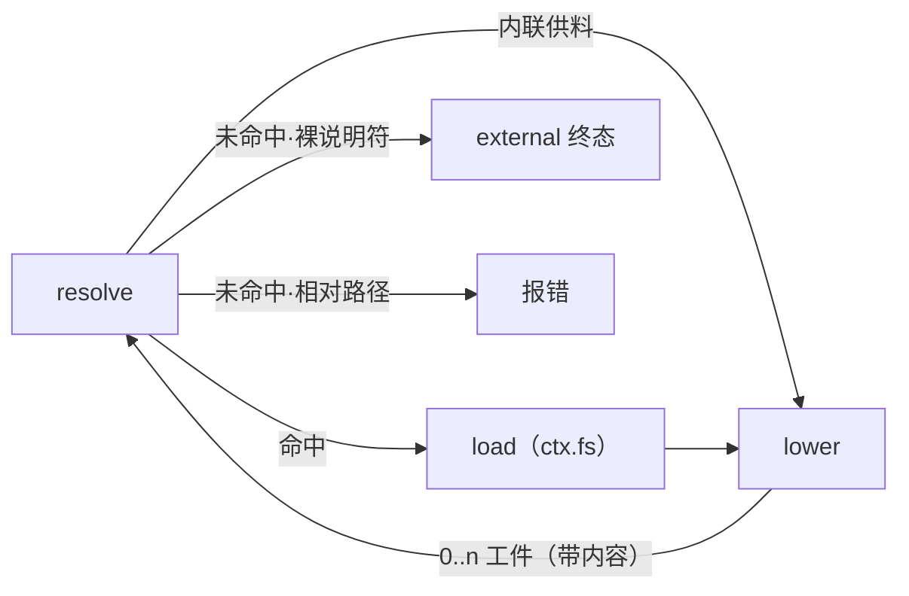

# @idealjs/stack

对标 vite/rollup 的 preserve-ESM 构建工具。v2 形态是**需求引擎**：引擎是 worklist 调度器
（FIFO，确定性），一切皆需求——模块需求（路径 P 的最终形态）与产出需求（`ctx.output`
登记即广播）。**静态分析决定流程，不决定规模**——图的规模运行时涌现。

## 产品定位

- **CLI 是 SDK 的薄壳**：包主导出（`.`）提供 `build(config): Promise<BuildResult>` 与全部
  类型，CLI（`bin/stack`）只是「读配置 → 补缺省 fs → 前置注入 imports() → 调 build →
  写盘打印」的宿主之一；
- **核心是 web standard 的**：`src/core/` 与 SDK 入口零 `node:` 导入（有测试断言）；平台
  I/O 只经注入 fs，跨平台仅需换 fs 注入。node 侧能力在 `./node` 子路径；
- **引擎零解析**：lower 返回的工件即终态，引擎不看内容；依赖图的唯一构成是 lower 内
  `await ctx.loweringImport(id)`（每次 await 登记边＋调度完整生命周期）；默认闭包由内置
  `imports()` 声明 hook 承担，工件可携带 imports 元数据（值区间＋解析 id）供渲染期引用
  重写，不携带则不重写；
- **单产出通道**：引擎登记第一份 `default` 规范产物（非特权产出方，只是第一个产出者），
  hook 经 `ctx.output` 追加衍生产物。登记即冻结（append-only）、登记即广播（watch 订阅）、
  重名报双来源（天然环断路器）。

## 快速开始

```bash
yarn workspace stack-demo build     # 示例工程：单入口 → default/min/bundle 三份产出
stack --config stack.config.ts      # 或 CLI 直用（--watch 防抖全量重建）
```

SDK 程序化调用与 CLI 走同一条链路：

```ts
import { build } from '@idealjs/stack'
const result = await build(config)  // BuildResult { outputs, moduleCount, durationMs }
// 宿主自行写盘——core 不碰 fs
```

## 配置模型（inputs / fs / load / hooks 四件套）

```ts
import { defineConfig } from '@idealjs/stack'
import { bundle, minify } from '@idealjs/stack/builtins'
import { nodeFs } from '@idealjs/stack/node'

export default defineConfig({
  root: '.',                            // 可选，默认 '.'
  inputs: [{ name: 'app', path: 'src/app.ts' }],  // 唯一的入口声明（初始模块需求）
  dist: 'dist/esm',                     // 可选，default 产物落位，默认 'dist'
  alias: { '@/': 'src/' },              // 前缀替换，target 是 root 相对路径
  fs: nodeFs(),                         // 平台注入；node CLI 缺省 nodeFs()，SDK/浏览器显式传入
  load: async (ctx, id) => ctx.fs.readFile(id),   // 配置级唯一加载器，必须经 ctx.fs
  hooks: [minify({ dir: 'dist/min' }), bundle({ entry: 'app', dir: 'dist/bundle' })],
})
```

- `Input[]` 是唯一的入口声明；`Output[]` 不是配置——由 hook 机制经 `ctx.output` 涌现；
- **输入类型**：每项可带 `type?: 'html' | 'css' | 'module'`，缺省按扩展名推断
  （`.html`/`.css`/其余 → module），显式 type 覆盖推断。module 走 esbuild 剥类型＋acorn
  长图；html 的 `script src`／`link rel=stylesheet href` 引用走 resolve 链长图、终态重写
  为最终产物相对路径（不剥类型、不进 SCC/bundle 闭包）；css 透传为终态工件、不产图边、
  可被 loweringImport 拉取——三种 kind 的生命周期差异见 protocol-v2「输入类型」；
- `fs: StackFs`（`readFile`/`writeFile`）；根导出 `memoryFs(files?)`（纯 Map，测试与浏览器
  用）；`load` 未配置时缺省 `ctx.fs.readFile`，候选探测（`.ts/.tsx/.js/.jsx/.mjs/index`）
  由引擎经同一注入 fs 完成；
- **直接 `import fs`（平台 API）是协议违例**：平台绑定只允许发生在 `fs` 注入处。

### 配置的两种加载法（node 路径 vs 源码）

- **node 宿主**：`import { loadConfig } from '@idealjs/stack/node'`——传**文件路径**，
  原生 import 走 node 24 type stripping，返回完整 `StackConfig`（defineConfig(...)）。
- **浏览器／内存场景**（配置是一段源码字符串，如宿主内存 FS 里的 stack.config.ts）：
  `import { loadConfigFromSource } from '@idealjs/stack'`——
  `loadConfigFromSource(code, { wasmURL? }): Promise<StackSourceConfig>`。esbuild-wasm
  transform 剥 TS（浏览器场景内部先 `initEsbuild(wasmURL)`，缺省 `/esbuild.wasm` 同源
  伺服；node 场景 transform 自动可用、跳过初始化）→ 前置注入
  `const defineConfig = (c) => c;`（配置源不 import 任何东西、纯数据导出）→ 模块求值
  （浏览器 Blob URL 动态 import；node 降级 data: URL，其 ESM loader 不认 blob: scheme）
  → 取 default（兼容 `config` 命名导出），非对象即响亮报错。
- **语义边界**：返回 `StackSourceConfig`（数据面：`inputs?: { name, path }[]`＋兼容
  `entry?: string`）而非完整 `StackConfig`——dist/hooks 由宿主固定（策略归宿主），配置
  只声明数据面；`fs`/`hooks` 这类平台绑定与函数字段不经配置源跨越（内联函数拿不到
  stack 的 builtins，写了也没有意义）。解析守卫：inputs 须为非空数组、每项有 name/path
  非空字符串（缺即响亮报错）；kind 由扩展名推断（`.html` → html、`.css` → css、其余
  module）。宿主自行映射 build inputs——inputs 与 entry 同时出现时 inputs 优先，entry
  等价单条 module 输入（`inputs: [{ name: 'demo', path: entry }]`）。

## 架构总览（两相两入口）



- **模块相**（内容从无到有）：resolve 模块需求 → resolve 链（纯函数、first-non-null、可内联
  供料 `{ id, content }`；全部未命中时裸说明符＝external 保留、相对/绝对路径＝报错）→
  load → lower 链（产物集累积，一化 0..n；0＝消费终结、恒等合法）→ 依赖图在 lower 内经
  `ctx.loweringImport` 声明式涌现，引擎零解析（工件即终态）；
- **产出相**（内容已存在的派生）：模块需求排干 → 引擎登记 `default`（preserve-ESM：入口
  公共祖先落位、说明符重写 `.ts→.js`、alias 与动态 import 字面量重写、external 保留）→
  derive hooks 按注册序触发 → 产出事件驱动 watch 命中的 lower → quiescence → seal →
  `BuildResult`；
- **纯度分类**：resolve 纯函数｜load 非纯、只经 ctx.fs｜lower 非纯、副作用唯一形态是
  ctx.output 登记。直接平台 API 是协议违例。

## 钩子协议

```ts
type StackHook =
  | { name; resolve?; lower?(id, artifacts, ctx): Artifact[] }   // 模块相
  | { name; watch: string[]; lower?(ctx, output): void }          // 产出相订阅
  | { name; derive?(ctx): void }                                   // 产出相图根
```

- resolve / load / lower / derive 一律可 `T | Promise<T>`；worklist FIFO 调度，确定性优先；
- hook 是**能力的注册表**，不是链上的位置：组合＝能力并集，插入无意义；
- **lower ctx API（五件套）**：

```ts
interface LowerContext {
  fs: { readFile(path: string): Promise<string> }        // 注入 fs 只读面
  output(spec: EmittedOutput): void                      // 唯一副作用：登记产出（登记即冻结）
  lowerImport(code: string): string[]                    // acorn 封装：静态＋动态 import 字面量
  loweringImport(id: string): Promise<FinalModule | null>  // await 即声明依赖边＋拉取终态（external 返回 null）
  loweringBindImport(ids: string[]): Promise<void>       // 环解法：绑定为同一单元，后续命中绑定缓存
}
```

- **声明依赖图**：`loweringImport` 登记边（detector.addEdge）→ resolve → ensureLifecycle
  完整生命周期 → 返回 FinalModule；被 await 模块的 lower 同样声明自己的依赖（递归
  await），传递闭包由声明链涌现。用户插件直接不管依赖也是合法的：不 await 就没有边；
  await 链成环 → 抛可捕获 `CycleError`（带环路径），catch 后 `ctx.loweringBindImport`
  解环（注册表把环上 ids 重定向到当前模块的终态 Promise＋挂起恢复＋循环检测器
  contract；绑定只做缓存重定向，内容处理归插件流程，后续 loweringImport 命中绑定缓存
  返回绑定单元终态）；
- **修正前人产出被无条件拒绝**：「final」是全称命题，开放链上不可证实（webpack stage
  数字军备竞赛即生态招供）；修正＝登记新产出；`seal()` 是全协议唯一的终态；
- 互指环走 token 晚绑定（演进方向，未实现，见 protocol-v2）。

## 循环依赖（分层作答）

| 层 | 环的处理 |
|---|---|
| 图层（不拉取终态） | 无害——不 await 就没有边，preserve-ESM 交给 ESM live binding 原生处理 |
| pull 层（loweringImport 终态） | `CycleError` 响亮报错（环上不存在终态全序，await 死锁）；正解 catch＋loweringBindImport |
| 产出层（拼接打包） | SCC 分解＋运行时包装（`__define/__require` 惰性函数），环在调用时自解 |

## 内置 hooks（`@idealjs/stack/builtins`）

策略与协议分离：根 API 只留协议面，内置能力在 builtins 子路径。

- `imports({ name? })`：**默认闭包载体**（模块相 lower）。对每个工件按 kind 提取引用并
  逐个 `await ctx.loweringImport`——module 用 lowerImport（静态＋动态字面量）、html 用
  parseHtmlAssets（script src／link stylesheet href）、css 透传不声明；声明完成后把引用
  值区间＋解析 id 作为工件 imports 元数据随工件返回，渲染期据此重写。自身闭环的
  CycleError 被捕获降级为边数据（环只在依赖边不在等待链，bundle 的 SCC 因此照常成立），
  他人抛来的环照常上抛。CLI 与示例默认注入；SDK 不自动注入——纯手动模式图完全由显式
  await 构成；
- `minify({ from?, name?, dir })`：`watch: [from ?? 'default']`，对产出做完整文件集——
  .js 走 esbuild-wasm 异步 minify、.css 走 css loader minify、其余文件（html）原样复制，
  登记 `{ name: name ?? 'min', dir }`——min 产出即完整可部署文件集，「按产出订阅」的范本；
- `bundle({ entry, dir, name?, runtime? })`：derive 图根。Tarjan SCC 分解（声明序
  tie-break）→ 表示切换：单点分量拼接（剥内部 import、external 保留）、多点分量 wrapped
  （`__define(id, fn)` 惰性函数＋import 改写 `const { x } = __require('id')` 解构近似＋入口
  `__require(entryId)` 启动，运行时模板 `runtime` 可覆写）。环语义由运行时保持，全程无
  await 无死锁。低层工具 `stronglyConnected`/`moduleRuntime` 同子路径导出（手写 derive 用）。
  行为规格见 [docs/recipe-single-file.md](./docs/recipe-single-file.md)；
- `inlineScript({ from?, name? })`：`watch: [from ?? 'default']`，对产出内的 html 做
  **script 内联**——文件级闭包拉齐（script 引用→同产出 js→相对 import 递归），复用
  wrapModule/moduleRuntime 做 wrap-all 包装，`<script src>` 整标签替换为单个内联
  `<script type="module">`，入口按原标签序 `__require`；登记 `{ name: name ??
  `${from}-inline`, dir }` 新产出（append-only，原产出不动）——产出自包含 html 页面的
  终点站（css 仍外链）。

## 产物布局（preserve-ESM）

- 以全部入口 id 的公共祖先目录为基，每模块按相对结构落位，module 扩展名 `.ts/.tsx → .js`，
  html/css 保留自身扩展名；lower 产物可自带显式 path（如 bundle.js）；
- 引用重写由工件 imports 元数据驱动：携带者按值区间把引用重写为最终相对路径（js 与
  html 同机制），不携带则不重写；external 不动；
- loweringBindImport 重定向后的模块以绑定单元（当前模块）的落位路径呈现，引用方重写指向它；
- `EmittedOutput.files` 内 `{ path, code }` 的 path 相对该产出自己的 dir。

## CLI

```bash
stack [--config stack.config.ts] [--watch]          # 构建 / watch 重建循环
stack dev [--port 8910] [--host] [--no-watch] [--base 前缀] [--asset 路由=文件]...  # watch ＋ hono dev server（伺服 default 产物目录；--base 让运行时可被前缀路径访问，code-server absproxy/隧道场景用；--host 暴露局域网）
stack preview [--port 9910] [--host] [--base 前缀] [--asset 路由=文件]...  # 伺服已构建产物（stack.config.ts 的 dist，需先构建；无 watch 无 live reload）
```

- 配置文件为 TS（node 24 type stripping 直载）；`fs` 未定义时 CLI 默认注入 `nodeFs()`；
- `stack dev` 启动即打 Vite 风格横幅（ready 耗时／Local／Network／h 帮助提示），TTY 下
  `h`＋回车看快捷键、`q`＋回车退出；`--host` 裸旗＝0.0.0.0，Network 行显示第一块非内网
  IPv4，`--host=地址` 显式指定；
- `stack preview` 伺服 stack.config.ts 定义产物目录里的已构建产物（含主入口 html）——
  需先跑 `stack`／`stack build`，目录缺失时响亮报错；横幅与 dev 同款（ready＝伺服就绪
  耗时）；`stack dev --no-watch` 与 preview 同一行为（不监听不热重载）；
- `stack dev` / `stack preview` 自带约定路由 `/esbuild.wasm` → stack 自带的 esbuild-wasm 副本（浏览器内
  stack 的 `initialize({ wasmURL: '/esbuild.wasm' })` 零配置可用；显式 `--asset` 同名路由
  优先）；额外静态路由用 `--asset 路由=文件` 注入；
  hooks 未含 imports() 时前置注入（默认闭包行为与 SDK 手动模式的差异见内置 hooks 节）；
- 摘要按产出顺序逐行打印 `name → dir（N 个文件，大小）`，末行报输入数/模块数/用时；
- `--watch` 用 `fs.watch` 递归监听（忽略 node_modules/dist/.git），150ms 防抖全量重建；
  配置文件本身的热重载不在 MVP 内（改配置需重启）；
- 产出写盘经注入 fs 的 `writeFile`——`dist` 未定义时默认 `dist`。

## 浏览器路线

核心与 SDK 入口只依赖 acorn 与 esbuild-wasm（两者均可浏览器运行）。`browser/` 是真实
harness（`stack dev` 构建并伺服，wasm 走 dev server 内建 `/esbuild.wasm` 路由），
`yarn test:browser`（Playwright，webServer 起 `stack dev` 于 5901 端口）在 chromium 里
跑全部内存 FS 场景并断言零 console error。

## 测试（双层）

- `yarn test`：node 侧——parse 说明符收集与 html 资产解析、循环检测器单测
  （`test/cycle.spec.ts`）、共享场景套件（含 await 环出路矩阵：未捕获响亮报错、
  loweringBindImport 绑定解环、imports() 闭环降级、bundle 环结构、watch 环断路、
  html/css 入口三种 kind 生命周期）、CLI 端到端（mini 与 cycle 夹具，后者断言单文件
  bundle 产物 node 可执行）、零 node: 断言；
- `yarn test:browser`：Playwright 断言 data-state=passed、用例数与场景数一致、零
  console error / pageerror；
- 场景单一事实源在 `test/scenarios.ts`：memoryFs 驱动 SDK build 全流程，node 的
  build.spec.ts 与浏览器 harness 共用同一套 `SCENARIOS` 与 `runScenario`。

## 代码结构（code as tree）

```
packages/stack/
├── bin/stack.mjs              #! 壳：读参数 → runCLI
├── src/
│   ├── index.ts               SDK 协议面出口（build/defineConfig/memoryFs/loadConfigFromSource/initEsbuild/CycleError/类型）
│   ├── builtins.ts            策略出口（imports/minify/bundle/inlineScript/stronglyConnected/moduleRuntime）
│   ├── core/
│   │   ├── config.ts          defineConfig 与 StackConfig/StackFs/StackInput 类型
│   │   ├── hooks.ts           StackHook 形态与各相 ctx 类型（纯度分类的载体）
│   │   ├── engine.ts          模块相引擎主干：DemandEngine（生命周期/调度/lower 链/loweringImport 委托，零解析）
│   │   ├── engine-types.ts    模块相数据形状（工件/注册表条目/队列任务）
│   │   ├── resources.ts       资源声明叶子：loweringImportFrom（声明边＋拉终态）/loweringBindImportFrom（绑定解环）
│   │   ├── loading.ts         装载转译叶子：probe/loadForLifecycle/strip/import 清理/顶层冲突
│   │   ├── cycle.ts           循环检测器叶子：addEdge 环检查＋可达性 memo＋contract＋CycleError
│   │   ├── channel.ts         产出通道：登记即冻结＋watch 广播＋重名双来源
│   │   ├── render.ts          default 规范产物渲染（imports 元数据驱动的落位与引用重写）
│   │   ├── imports.ts         imports() 内置声明 hook：按 kind 提取引用逐个声明边并附元数据
│   │   ├── bundle.ts          SCC 分解＋双表示打包（hoisted 拼接/wrapped 运行时）
│   │   ├── scc.ts             强连通分量（Tarjan，声明序 tie-break）
│   │   ├── minify.ts          压缩内置 hook
│   │   ├── memoryFs.ts        内存 fs（测试与浏览器）
│   │   ├── esbuildRuntime.ts  esbuild-wasm 浏览器初始化守卫（initEsbuild，一次守卫全宿主共享）
│   │   ├── loadConfigSource.ts 配置源加载：transform 剥 TS＋defineConfig 注入＋动态 import
│   │   ├── parse.ts           acorn import/export/顶层名收集
│   │   ├── parseHtml.ts       web-standard 正则提取 html 资产引用（script src／link stylesheet href，带值区间 offset）
│   │   └── pathUtil.ts        抽象路径运算与候选探测
│   └── node/
│       ├── fs.ts              nodeFs()
│       ├── cli.ts             runCLI（--config/--watch/摘要/写盘）
│       └── index.ts           node 出口（nodeFs/runCLI）
├── test/                      场景单一事实源＋检测器单测＋CLI e2e＋零 node: 断言
├── browser/ ＋ e2e/            浏览器 harness 与 Playwright（双层测试的浏览器侧）
└── docs/                      深读文档（见下索引）
```

## MVP 边界（明确不做）

- scope hoisting、code splitting、sourcemap；
- bare specifier 的 node_modules 解析（一律 external）；
- img 等二进制资产与 token 晚绑定（协议已留演进方向；html/css 入口已支持）；
- html 解析是 web-standard 正则＋属性值区间，无完整 HTML AST、畸形 HTML 不保证；
  css 的 `@import` 不展开、不产图边；loweringBindImport 仅适用 module kind（绑定单元的
  内容处理是 js 语义，归插件流程）；
- 缓存与增量构建（watch 是防抖全量重建）；
- bundle wrapped 表示的标识符级 scope 分析（解构近似，边界见 recipe-single-file）；
- 无限产出链以 quiescence 不达暴露（MVP 不设上限）。

## 文档索引

| 文档 | 定位 |
|---|---|
| [docs/protocol-v2.md](./docs/protocol-v2.md) | v2 协议权威规格：根因判定、需求引擎、两相两入口、纯度定律、循环依赖分层作答、命名与拒绝清单 |
| [docs/recipe-single-file.md](./docs/recipe-single-file.md) | 范本：A import B, C → 单文件脚本（pull-in-lower 主形态、SCC 有环解法、derive 对照） |
| [docs/plugin-loop.md](./docs/plugin-loop.md) | v1 历史记录：buildEnd 顺序链的产出模型（已被 v2 取代，留作设计演化档案） |
