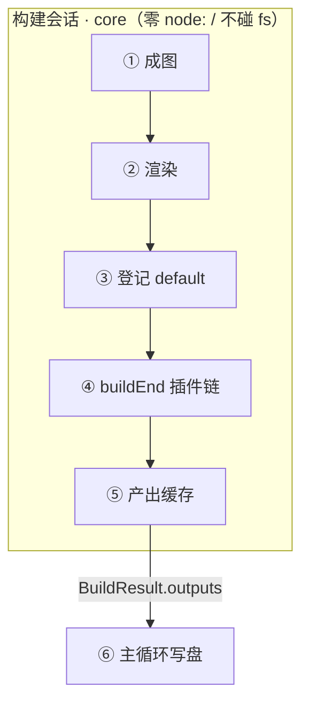

# 产出模型与插件循环

`@idealjs/stack` 的产出协议权威记录。改 `core/build.ts`、`core/plugin.ts` 或任何钩子
语义前先读这份；本文与实现不一致时，先修实现或先修文档，不允许带着分歧合并。

## 单产出通道

rollup 的产出有两条轨——`output` 配置驱动的渲染、插件 `emitFile` 侧通道——钩子因此
分裂成「每输出跑一次」与「整个构建跑一次」两族，行为推理成本高。stack 收敛为单轨：

- `ctx.output({ name, dir, files })` 是**唯一的产物登记 API**，且只在 `buildEnd` 阶段
  可用（transform/load 阶段产出＝双轨怪味本体，协议禁止）；
- 核心构建完模块图后**也走同一通道**先登记规范产物
  `{ name: 'default', dir: config.dist ?? 'dist' }`——核心不是特权产出者，只是第一个
  产出方；
- 产出按登记序缓存进构建会话，重名抛错并报出两个来源插件名；`BuildResult.outputs`
  返回给宿主，由宿主主循环统一写盘——core 零 `node:`、不碰 fs。

## 配置形态

```ts
// stack.config.ts
import { defineConfig, minify } from '@idealjs/stack'

export default defineConfig({
  root: '.',
  inputs: [
    { name: 'app', path: 'src/app.ts' },
    { name: 'tool', path: 'src/tool.ts' },
  ],
  dist: 'dist',
  alias: { '@/': 'src/' },
  plugins: [minify({ dir: 'dist/min' })],
})
```

`inputs` 定义构建什么；「多少份产物」不再是配置运算子（n×m 笛卡尔积的旧设计已废），
而是插件组合的结果——每个插件经产出通道追加自己的衍生产物。

## 三条不变量（output 语义歧义的钉死）

「插件读取先前产出作为输入，会不会被后续插件吞掉」——不可能，协议从签名上排除：

1. **产出即终态（append-only）**：`ctx.output` 只登记新产物，登记后不可变；不存在
   删除/改写已产出的 API。rollup 的 `generateBundle` 可以 `delete bundle[key]`——
   「吞掉」在那里是 API 允许的；stack 刻意不提供。
2. **通道不对称**：`ctx.outputs` 是冻结只读视图——minify 读 default 是引用不是消费，
   读完后 default 原样还在。
3. **写盘滞后于全部产出**：所有插件跑完后宿主主循环才统一写盘——任何时刻「我输出了」
   都为真，default 与 min 最终并存落盘（`dist/` 与 `dist/min/`）。

## 范本插件：minify

内置 `minify({ from?, name?, dir })` 是「以前产出为输入、登记衍生产出」的完整范本：

```ts
export function minify(options: { from?: string; name?: string; dir: string } = {}): StackPlugin {
  const from = options.from ?? 'default'
  return {
    name: 'minify',
    async buildEnd(ctx) {
      const source = ctx.outputs.find((o) => o.name === from) // 只读引用
      if (!source) throw new Error(`minify: 找不到产出「${from}」`)
      const files = await Promise.all(
        source.files.map(async (f) =>
          f.path.endsWith('.js') ? { path: f.path, code: await transformMinify(f.code) } : f,
        ),
      )
      ctx.output({ name: options.name ?? 'min', dir: options.dir, files })
    },
  }
}
```

## 整体循环



各块职责：

- **① 成图**——n 个 `inputs`（`{ name, path }` 对象数组）各自成图：`resolveId → load →
  transform 链 → esbuild 剥类型 → acorn 解析依赖`；循环依赖入图即止。
- **② 渲染**——规范产物渲染：按入口公共祖先相对结构落位，说明符重写（`.ts→.js`、
  alias、动态 import 字面量）。
- **③ 登记 default**——core 经与插件完全相同的通道登记规范产物
  `{ name: 'default', dir: config.dist ?? 'dist' }`；核心只是第一个产出方，不是特权
  产出者。
- **④ buildEnd 插件链**——按声明顺序逐个执行：插件经只读的 `ctx.outputs` 引用先前
  产出（可选），经 `ctx.output(spec)` 登记新产出（重名抛错并报出两个来源插件名）。
- **⑤ 产出缓存**——`EmittedOutput[]` 按登记序；append-only，登记后不可变。
- **⑥ 主循环写盘**——宿主（CLI / SDK 调用方）拿 `BuildResult.outputs` 按登记序统一
  写盘；core 不碰 fs。

## 钩子协议与 async 纪律

- `resolveId` / `load` / `transform` / `buildEnd` 返回值一律 `T | Promise<T>`，调度器
  **顺序 await、绝不并行**——同一构建的钩子调用序恒定，确定性优先；
- `buildEnd` 的「只看到排在前面的产出」不变量依赖顺序性，并行化此阶段等于破坏协议；
- `ctx.output()` 本身是同步 void——登记进缓存是同步动作，异步的是登记之前的加工
  （如 await esbuild 压缩完再登记）；
- 钩子可异步是硬需求而非便利：esbuild-wasm 的 JS API 只有异步形态（浏览器宿主里
  wasm 天然异步），内置 minify 自身就依赖它；web-standard 的文件读取（fetch、OPFS
  `getFile()`）皆为 Promise，浏览器宿主的 `load`/`resolveId` 注定 async。

## 测试对照

场景单一事实源 `test/scenarios.ts` 中与本文对应的守卫：插件 `ctx.output` 登记生效、
重名抛错带来源插件名、transform 阶段产出被拒、async 插件（load 与 buildEnd 的
await 路径）在 node 与浏览器双层同测。改协议先改场景，再改实现。
