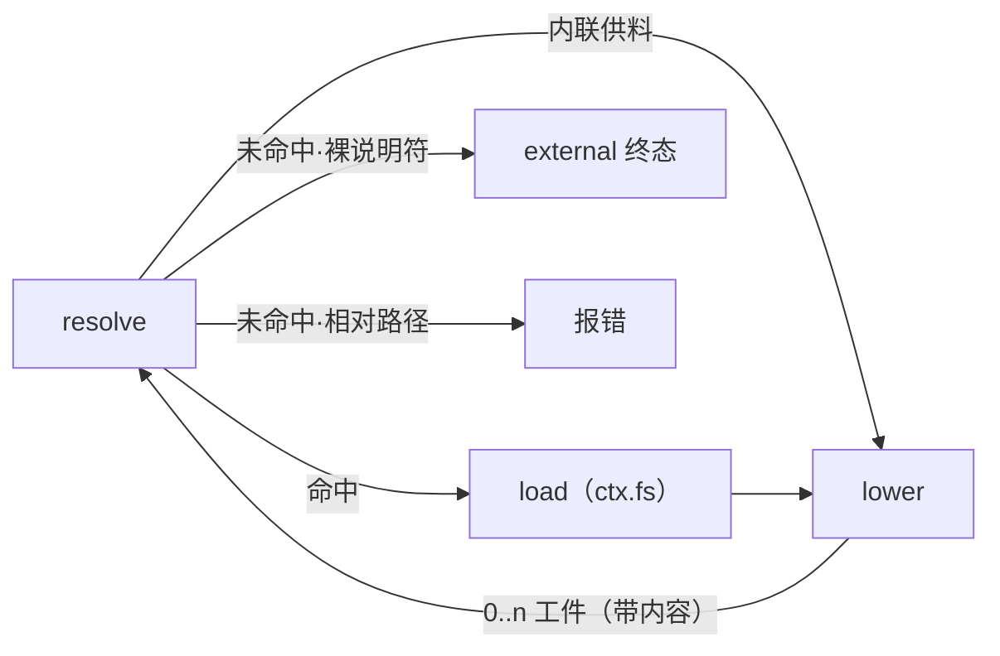

# stack v2 协议：需求引擎（设计规格）

本文是 v2 协议的权威设计记录。v1（buildEnd 顺序链）的产出模型见
[plugin-loop.md](./plugin-loop.md)；v2 落地后本文升级为实现规格，plugin-loop.md 保留
为 v1 历史。

## 根因判定

v1 的三症状——preset 组合、链中插入、产物互指环——同源于**插件顺序执行**：位置是
依赖关系的间接编码，跨信任边界后位置不可见。注册 hook 与声明式等待都只是给顺序换
计算器（登记序 vs 依赖推导序），全局序列未被质疑。webpack 的对照：动态增长是对的
（工作队列让图边编译边长），可变性劫持增长是错的（收敛循环、stage 军备竞赛），n:1
产出袋只收缩（seal 后模块集封死，结构性新增被禁）。

v2 的立场：**静态分析决定流程，不决定规模**——图的规模运行时涌现，协议的第一公民
是需求与调度，不是链与位置。

## 世界观：一切皆需求

引擎是 worklist 调度器（FIFO，确定性，无时钟依赖）。两类需求：

- **模块需求**：「路径 P 指向的模块的最终形态」；
- **产出需求**：「产出 O 的工件集」。

hook 是**能力的注册表**，不是链上的位置：组合＝能力并集；preset＝能力集合；插入无
意义；无声明顺序概念。

## 配置形态：inputs / fs / load / hooks

```ts
// stack.config.ts
import { defineConfig, nodeFs } from '@idealjs/stack/node'

export default defineConfig({
  inputs: [{ name: 'app', path: 'src/app.ts' }],
  fs: nodeFs(),                 // 简化 fs：宿主注入（浏览器宿主注入内存/OPFS 实现）
  load: async (ctx, id) => {    // 自定义通用加载器——配置级唯一 load，非 hook 链成员
    return ctx.fs.readFile(id)  // 必须经 ctx.fs；禁止直接 import fs（见「纯度分类」）
  },
  hooks: [
    { name: 'md', resolve: ..., lower: ... },
    minify({ dir: 'dist/min' }),
  ],
})
```

- `Input[]` 是配置里唯一的入口声明（初始模块需求）；`Output[]` 不是配置——由 hook
  机制经 `ctx.output` 涌现；
- **fs 与 load 都是配置级注入**：平台绑定收拢在宿主编写配置的那一刻，core 与 hooks
  全程平台无关。

## 模块相：resolve → load → lower



- `resolve(specifier, importer, ctx)`：**纯函数**。链式 first-non-null；返回 load
  所需的数据（`{ id }`）；可**内联供料**返回 `{ id, content }`（纯数据，虚拟模块的
  替代形态）。身份归一是 resolve 存在的理由：N 个 specifier 归一一个 id，图去重、
  环检测、落位全以稳定 id 为键。resolve→load 分立的理由因此成立：身份与来源正交，
  平台差异全部收拢在 load 的 `ctx.fs` 后面。
- `load(ctx, id)`：**配置级自定义通用加载器**，不是 hook 链成员——全局一个，所有
  无内联内容的 demand 都经它。**必须使用 ctx 提供的 fs 接口**；文档显式标注：
  **不建议在 load 里直接 `import fs`**——直接平台 API 是平台锁定与合并冲突的源头
  （带平台假设的 load 无法跨宿主复用），注入 fs 下跨平台仅需换 `fs` 实现。
- `lower(id, artifact, ctx)`：**非纯函数**。链式产物集累积（每 hook 拿前一环产物集、
  返回新产物集），一化为 0..n 工件；0＝消费终结，恒等合法。**lower 会调用 ctx 的
  输出函数（ctx.output）把转化结果存储进产出**；产物带内容作为新 demand 回到
  resolve——图在 lower 处分叉、在 import 处增长，全程需求递归，无全局循环。
  插件按 id 自筛目标（rollup transform 同款纪律：非目标恒等返回）。

命名定案：**lower**（裂变语义；compiler lowering 行话——高级结构降为多个低级结构，
一化多的最精确行业词）。弃选记录：transform（1:1 整形）、expand（技术填充味）、
spawn（孵化义准但让位）、generate/emit（产出层撞车）、decompose（部分和＝整体）。

## 产出相：output 即事件，hook 按资源订阅

`ctx.output({ name, dir, files })` 登记产出——**登记同时是一次事件广播**：监听了
对应资源的 hook 被触发。因此 output 通道设计为 **hook 可注册的形式**：

```ts
{
  name: 'css-processor',
  watch: ['css'],                 // 订阅的资源名（产出名）
  lower: (ctx, output) => {       // 对应产出登记时被触发，可再登记新产出
    ctx.output({ name: 'css-min', dir: 'dist/css', files: ... })
  },
}
```

- 模块相排干后，产出相按订阅关系调度（声明依赖取代运行时断言，v1 的 requireOutput
  退场）；订阅成环 → 拒绝；
- 产出**登记即冻结**（append-only 日志，内容快照＋冻结）：订阅者拿到的是稳定身份；
  **修正前人产出被无条件拒绝**——「final」是全称命题，开放链上不可证实（webpack
  stage 数字军备竞赛即生态招供）；修正＝登记新产出；
- **互指环走 token 晚绑定**：输出内容允许按产出名的引用 token，宿主写盘期唯一一次
  展开——引用与兑现分离，永远不需要 B 的内容来引用 B；
- 无限产出链（订阅链不断登记新名字）属插件 bug，协议以 quiescence 不达暴露之。

## 纯度分类

| 钩子 | 纯度 | I/O |
|---|---|---|
| resolve | 纯函数 | 无 |
| load | 非纯 | **只经 ctx.fs**（注入 fs）；禁止直接 import fs |
| lower | 非纯 | 无 I/O；副作用唯一形态是 ctx.output 登记（登记即冻结） |

直接 import 平台 API（`node:fs`、裸 fetch）是协议违例：平台绑定只允许发生在
`defineConfig` 的 `fs` 注入处——**跨平台仅需换 fs 注入**，hook 层零平台动词。

## 明确拒绝（记录在案）

enforce/优先级数字、逆序 preset、惰性挂起调度（worklist 重试）、finalize 覆盖（重名
登记即报错，append-only 是天然的环断路器）、stage 军备竞赛、双轨产出、插件链 load、
load 直接 import fs。

## v1 → v2 映射

- 模块层语义不变：parse/graph/alias/external/preserve-ESM 落位与说明符重写原样；
- **buildEnd 顺序链退场** → lower 链（模块相）＋ watch 订阅（产出相）；
- requireOutput 退场（产出订阅取代运行时断言）；冻结存活且更重要；
- `nodeFsPlugin` → `nodeFs()`（配置级 fs 注入）；`memoryFs()` 承担测试/浏览器场景；
- 场景单一事实源改写为 v2 场景；双层测试（node＋chromium）架构不变。
