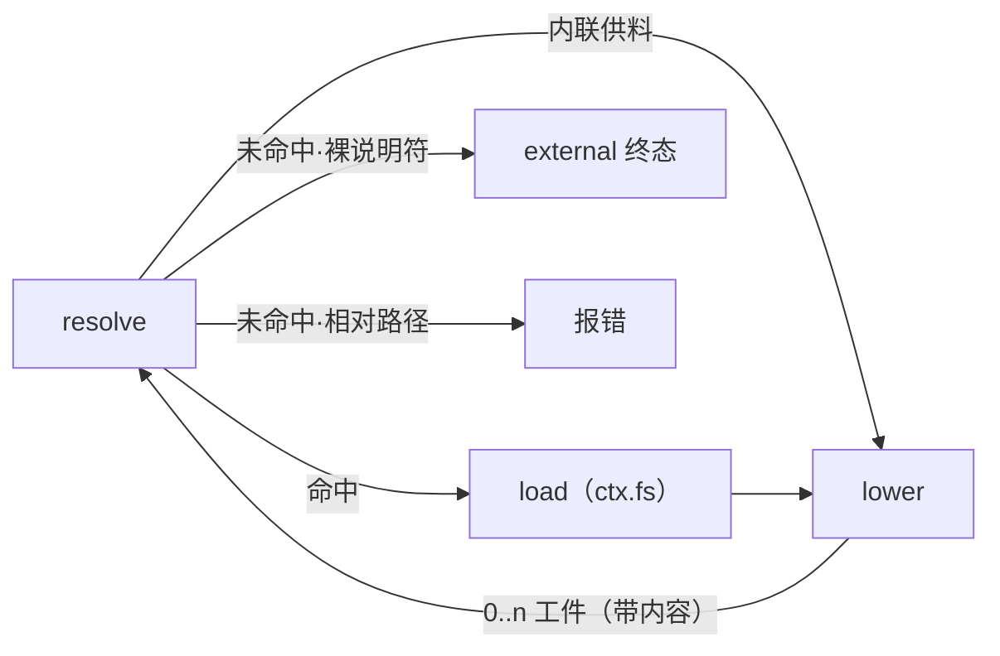

# stack v2 协议：需求引擎（设计规格）

本文是 v2 协议的权威设计记录。v1（buildEnd 顺序链）的产出模型见
[plugin-loop.md](./plugin-loop.md)；v2 落地后本文升级为实现规格，plugin-loop.md 保留
为 v1 历史。

## 根因判定

v1 的三症状——preset 组合、链中插入、产物互指环——同源于**插件顺序执行**：位置是
依赖关系的间接编码，跨信任边界后位置不可见。注册 hook 与声明式等待都只是给顺序换
计算器（登记序 vs 依赖推导序），全局序列未被质疑。webpack 的对照：动态增长是对的
（工作队列让图边编译边长），可变性劫持增长是错的（收敛循环、stage 军备竞赛），n:1
产出袋只收缩（seal 后模块集封死，结构性新增被禁）。

v2 的立场：**静态分析决定流程，不决定规模**——图的规模运行时涌现，协议的第一公民
是需求与调度，不是链与位置。

## 世界观：一切皆需求

引擎是 worklist 调度器（FIFO，确定性，无时钟依赖）。两类需求：

- **模块需求**：「路径 P 指向的模块的最终形态」；
- **产出需求**：「产出 O 的工件集」。

hook 是**能力的注册表**，不是链上的位置：组合＝能力并集；preset＝能力集合；插入无
意义；无声明顺序概念。

## 配置形态：inputs / fs / load / hooks

```ts
// stack.config.ts
import { defineConfig, nodeFs } from '@idealjs/stack/node'

export default defineConfig({
  inputs: [{ name: 'app', path: 'src/app.ts' }],
  fs: nodeFs(),                 // 简化 fs：宿主注入（浏览器宿主注入内存/OPFS 实现）
  load: async (ctx, id) => {    // 自定义通用加载器——配置级唯一 load，非 hook 链成员
    return ctx.fs.readFile(id)  // 必须经 ctx.fs；禁止直接 import fs（见「纯度分类」）
  },
  hooks: [
    { name: 'md', resolve: ..., lower: ... },
    minify({ dir: 'dist/min' }),
  ],
})
```

- `Input[]` 是配置里唯一的入口声明（初始模块需求）；`Output[]` 不是配置——由 hook
  机制经 `ctx.output` 涌现；
- **fs 与 load 都是配置级注入**：平台绑定收拢在宿主编写配置的那一刻，core 与 hooks
  全程平台无关。

## 模块相：resolve → load → lower



- `resolve(specifier, importer, ctx)`：**纯函数**。链式 first-non-null；返回 load
  所需的数据（`{ id }`）；可**内联供料**返回 `{ id, content }`（纯数据，虚拟模块的
  替代形态）。身份归一是 resolve 存在的理由：N 个 specifier 归一一个 id，图去重、
  环检测、落位全以稳定 id 为键。resolve→load 分立的理由因此成立：身份与来源正交，
  平台差异全部收拢在 load 的 `ctx.fs` 后面。
- `load(ctx, id)`：**配置级自定义通用加载器**，不是 hook 链成员——全局一个，所有
  无内联内容的 demand 都经它。**必须使用 ctx 提供的 fs 接口**；文档显式标注：
  **不建议在 load 里直接 `import fs`**——直接平台 API 是平台锁定与合并冲突的源头
  （带平台假设的 load 无法跨宿主复用），注入 fs 下跨平台仅需换 `fs` 实现。
- `lower(id, artifacts, ctx)`：**非纯函数**。链式产物集累积（每 hook 拿前一环产物集、
  返回新产物集），一化为 0..n 工件；0＝消费终结，恒等合法。**lower 会调用 ctx 的
  输出函数（ctx.output）把转化结果存储进产出**；产物带内容作为新 demand 回到
  resolve——图在 lower 处分叉、在 import 处增长，全程需求递归，无全局循环。
  插件按 id 自筛目标（rollup transform 同款纪律：非目标恒等返回）。

lower 的 ctx API——细粒度资源等待（lower 可以拉取依赖模块的终态，单文件打包因此
能在模块相完成，无须等模块集排干）：

```ts
interface LowerContext {
  fs: { readFile(path: string): Promise<string> }   // 注入 fs 只读面
  output(spec: EmittedOutput): void                  // 唯一副作用：登记产出（登记即冻结）
  lowerImport(code: string): Specifier[]            // 工具：acorn 封装（静态＋动态字面量）
  demand(specifiers: string[]): Promise<FinalModule[]>  // 递归需求：拉取依赖终态（环时抛可捕获 CycleError）
  merge(specifiers: string[], name?: string): Promise<FinalModule>  // 环解法：load 结果精确清理→合并→注册新模块
}
```

- `ctx.lowerImport`：供 lower 分析自身输入（引擎对 lower 返回的工件必再解析以长图，
  工具与引擎共用同一解析器，双解析可按内容缓存）；
- **`ctx.demand(specifiers)`**：拉取依赖的**传递闭包终态**——每个 specifier 经 resolve
  链（相对当前 id，alias 生效）→ 完整生命周期（load→lower）→ 最终形态；语义四条：
  传递闭包（依赖的依赖一并拉取）、依赖先行排序（声明序 tie-break）、按 id 去重
  （并发/重复 demand 共享同一 Promise）、external 跳过（保留为 import 语句）；
  **await 链成环 → 抛可捕获的 `CycleError`（带环路径）**——默认响亮（未捕获即构建
  失败），捕获后由插件决定如何处理（见「循环检测器与 merge 解环」）。
  工程纪律：merge/join 是插件侧组合动作，协议供 lowerImport＋demand＋merge 三个工具；
- 被 demand 的模块仍留在注册表：materialize 类产出自行筛选（如仅入口），避免双份。

命名定案：**lower**（裂变语义；compiler lowering 行话——高级结构降为多个低级结构，
一化多的最精确行业词）。弃选记录：transform（1:1 整形）、expand（技术填充味）、
spawn（孵化义准但让位）、generate/emit（产出层撞车）、decompose（部分和＝整体）。

## 产出相：output 即事件，hook 按资源订阅

`ctx.output({ name, dir, files })` 登记产出——**登记同时是一次事件广播**：监听了
对应资源的 hook 被触发。因此 output 通道设计为 **hook 可注册的形式**：

```ts
{
  name: 'css-processor',
  watch: ['css'],                 // 订阅的资源名（产出名）
  lower: (ctx, output) => {       // 对应产出登记时被触发，可再登记新产出
    ctx.output({ name: 'css-min', dir: 'dist/css', files: ... })
  },
}
```

- 模块相排干后，产出相按订阅关系调度（声明依赖取代运行时断言，v1 的 requireOutput
  退场）；订阅成环 → 拒绝；
- 产出**登记即冻结**（append-only 日志，内容快照＋冻结）：订阅者拿到的是稳定身份；
  **修正前人产出被无条件拒绝**——「final」是全称命题，开放链上不可证实（webpack
  stage 数字军备竞赛即生态招供）；修正＝登记新产出；
- **互指环走 token 晚绑定**：输出内容允许按产出名的引用 token，宿主写盘期唯一一次
  展开——引用与兑现分离，永远不需要 B 的内容来引用 B；
- 无限产出链（订阅链不断登记新名字）属插件 bug，协议以 quiescence 不达暴露之；
- 产出相 hook 的两种调度来源：`derive(ctx)`（图根派生——模块集排干触发，ctx 含终态
  模块集与依赖边）与 `watch` ＋ `lower`（产出触发——监听的产出登记即触发）。应用
  范本见 [recipe-single-file.md](./recipe-single-file.md)（A import B, C → 单文件
  脚本：打包是产出相的一次派生，不是引擎职责）。

## 循环依赖：分层作答

环的解法取决于在哪一层遇到它——三层三种答案，混层是混乱之源：

- **图层（模块需求递归，不拉取终态）——环无害**。需求图是图不是树：A→B→A 只是
  「B 已在访问中，入图即止」（注册表按 id 去重）。不 pull 的环原样交给运行时——
  ESM 原生以 live binding（绑定是引用不是值拷贝）＋函数提升处理环；preserve-ESM
  默认输出正是这种形态。
- **pull 层（demand 终态）——环抛 `CycleError`，可捕获、由插件决定处理**。机制：
  A 的 lower await demand(B) 挂起 → 引擎调度 B → B 的 lower await demand(A) →
  环检测命中（A 已在等待链上）→ 抛 `CycleError` 给新边发起者。语义上「B 的终态」
  依赖「A 的终态」依赖「B 的终态」——环上不存在终态全序，demand「返回终态」的承诺
  不可满足，因此只能以异常退出。**协议认可的正解是 catch 后 `ctx.merge` 解环**（见
  下节），不拉取/重构/derive 包装保留为同等合法出口。
- **产出层（拼接打包）——环需要模块运行时包装，唯一保语义的解**。拼接是「值快照」
  （把 B 的绑定以拼接时的值内联），而环的语义恰是绑定活性（B 导出的函数被调用时
  可能引用 A 后来才初始化的变量），快照直接破坏它（TDZ/undefined）。包装把「求值
  顺序问题」转化为「运行时惰性问题」：每模块降为 `__module(id, fn)` 注册的惰性
  函数、跨模块引用降为 `__require(id)` 运行时取用，环在调用时自解（webpack
  bootstrap、rollup cyclic chunk 同此原理）；包装属于产出相 derive（需整闭包知识，
  集合级重组）。

用户侧三条出路（随 await 环错误信息给出）：

① 不拉取——只需要「它存在」不需要「它的内容」时保留 import 交给运行时；
② **重构解环**——共享部分抽到第三个模块（教程场景首选，循环依赖本来就该修）；
③ **环上的打包放错相了，改放产出相 derive**：lower ＋ await demand 的组合契约是
「返回终态」，只适用于 DAG；derive 触发时所有 lower 已完成、无 await 挂起，环只在
依赖边（数据）不在等待链（控制）里，死锁条件消失——包装之：

```ts
{
  name: 'bundle-with-cycle',
  derive(ctx) {
    const closure = collectClosure(ctx.modules, ctx.inputs) // 环在依赖边里，无害
    const body = closure
      .map((m) => `__define('${m.id}', (exports, require) => {\n${stripImports(m.code)}\n})`)
      .join('\n')
    ctx.output({
      name: 'bundle',
      dir: 'dist',
      files: [{ path: 'bundle.js', code: `${RUNTIME}\n${body}\n__require('${entry}')` }],
    })
  },
}
```

包装把环从「编译期求值顺序问题」转化为「运行时惰性问题」：每模块是惰性函数，
`__require` 调用时取用，活性经 exports 对象保持。通用形态是内置 hook
`bundle()`（与 minify 同位）：SCC 分解（Tarjan）→ 表示切换（单点分量拼接、多点
分量 wrapped）→ import 改写为 `__require` 解构 → 单文件登记；支撑结构
（依赖边暴露、`stronglyConnected`、`moduleRuntime`）见
[recipe-single-file.md](./recipe-single-file.md)。

## 循环检测器（独立纯模块）与 merge 解环

**循环检测器**（`core/cycle.ts`，独立叶子、纯计算、无 I/O）：增量维护依赖图，每次
加边做一次环检查（「加 u→v 是否成环」等价于「v 可达 u」），用可达性 memo 加速。
memo 的 sound 条件是「图只增」——**merge 的注册表重定向是节点收缩，打破该条件**，
因此 merge 完成后必须调用检测器的收缩更新：

- `contract(ids, into)`：① 别名归一——后续指向 a/b 的边与查询规范化到 merged；
  ② 可达性 memo 整体重建（O(V+E)，bitset）——收缩改变可达性结构，增量失效不如
  重建可靠；
- 成本分账：`addEdge`（每次 demand 的热路径）保持 memo 加速；`contract`（仅环消解
  时发生）重建——冷事件的重建造价可接受。

命中即抛 `CycleError`（`path: string[]` 环路径；可捕获，`instanceof` 判型）。

**`ctx.merge(specifiers, name?)` 解环**（引擎工具，插件在 CycleError 的 catch 里调用）：

1. 取环内模块的 **load 结果**（load 先于 lower 完成，与死锁无关）；
2. **精确 import 清理**：移除环内互指的 import 声明（按解析后的 id 判定，非正则），
   external 保留；
3. 拼接为一份内容，**注册为新模块**（name 缺省 `merged:a+b` 形态），注册表将 A、B
   **重定向**到合并体；
4. 重定向**同时解除环上全体挂起**——pending 的 demand 命中缓存拿到合并体，挂起的
   lower 恢复执行。环上双方任一方 catch 并 merge，即解全体；
5. **同步循环检测器 `contract`**：a、b 收缩到合并节点（别名归一＋memo 重建）——
   检测器的图与真实依赖图保持一致，后续加边的环检查在新结构上进行。

语义边界如实记录：merge 以 **load 结果**为原料，原 lower 不再对合并体执行（合并即
替代）；顶层标识符冲突需处理（MVP：检测到即报错，scope 分析改名为升级路径）。

## 纯度分类

| 钩子 | 纯度 | I/O |
|---|---|---|
| resolve | 纯函数 | 无 |
| load | 非纯 | **只经 ctx.fs**（注入 fs）；禁止直接 import fs |
| lower | 非纯 | 无 I/O；副作用唯一形态是 ctx.output 登记（登记即冻结） |

直接 import 平台 API（`node:fs`、裸 fetch）是协议违例：平台绑定只允许发生在
`defineConfig` 的 `fs` 注入处——**跨平台仅需换 fs 注入**，hook 层零平台动词。

## 明确拒绝（记录在案）

enforce/优先级数字、逆序 preset、惰性挂起调度（worklist 重试）、finalize 覆盖（重名
登记即报错，append-only 是天然的环断路器）、stage 军备竞赛、双轨产出、插件链 load、
load 直接 import fs。

## v1 → v2 映射

- 模块层语义不变：parse/graph/alias/external/preserve-ESM 落位与说明符重写原样；
- **buildEnd 顺序链退场** → lower 链（模块相）＋ watch 订阅（产出相）；
- requireOutput 退场（产出订阅取代运行时断言）；冻结存活且更重要；
- `nodeFsPlugin` → `nodeFs()`（配置级 fs 注入）；`memoryFs()` 承担测试/浏览器场景；
- 场景单一事实源改写为 v2 场景；双层测试（node＋chromium）架构不变。
