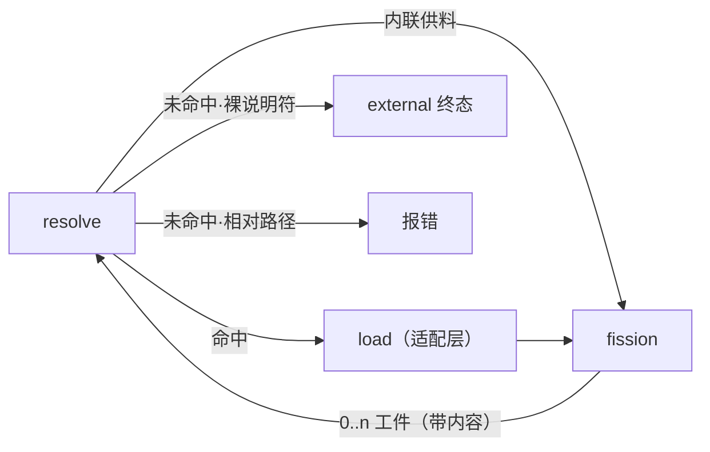

# stack v2 协议：需求引擎（设计规格）

本文是 v2 协议的权威设计记录。v1（buildEnd 顺序链）的产出模型见
[plugin-loop.md](./plugin-loop.md)；v2 落地后本文升级为实现规格，plugin-loop.md 保留
为 v1 历史。

## 根因判定

v1 的三症状——preset 组合、链中插入、产物互指环——同源于**插件顺序执行**：位置是
依赖关系的间接编码，跨信任边界后位置不可见。注册 hook 与声明式等待都只是给顺序换
计算器（登记序 vs 依赖推导序），全局序列未被质疑。webpack 的对照：动态增长是对的
（工作队列让图边编译边长），可变性劫持增长是错的（收敛循环、stage 军备竞赛），n:1
产出袋只收缩（seal 后模块集封死，结构性新增被禁）。

v2 的立场：**静态分析决定流程，不决定规模**——图的规模运行时涌现，协议的第一公民
是需求与调度，不是链与位置。

## 世界观：一切皆需求

引擎是 worklist 调度器（FIFO，确定性，无时钟依赖）。两类需求：

- **模块需求**：「路径 P 指向的模块的最终形态」；
- **产出需求**：「产出 O 的工件集」。

插件是**能力的注册表**，不是链上的位置：组合＝能力并集；preset＝能力集合；插入无
意义；无声明顺序概念。

## 两相两入口

### 模块相（内容从无到有）

入口＝resolve demand。状态机：



- `resolve(specifier, importer)`：链式 first-non-null。返回 `{ id }`；可**内联供料**
  返回 `{ id, content }`（纯数据，虚拟模块的替代形态——不碰平台 I/O，锁不住平台）。
  身份归一是 resolve 存在的理由：N 个 specifier 归一一个 id，图去重、环检测、落位
  全以稳定 id 为键。
- `load`：引擎驱动的生命周期一步，**走注入 fs**（`fs.readFile`），不是插件钩子。
  仅对无内联内容的 demand 执行（resolve 内联供料与 fission 产物自带内容，跳过）。
- `fission(id, artifact)`：链式产物集累积（每插件拿前一环产物集、返回新产物集），
  一化为 0..n 工件；0＝消费终结（过滤），恒等合法。产物带内容作为新 demand 回到
  resolve——**图在 fission 处分叉、在 import 处增长**，全程需求递归，无全局循环。
  插件按 id 自筛目标（rollup transform 同款纪律：非目标恒等返回）。

### 产出相（内容已存在的派生）

入口＝derive 声明，非 resolve：

- `derive({ from: OutputName[], name, dir, fn })`：`from` 声明依赖产出名，引擎按其
  拓扑调度（来源产出登记完成即就绪）；`fn(来源工件集, 模块集)` 登记新产出。
- `from` 成环 → 拒绝；产出名唯一 → 冲突报错并带两个来源。
- 分层卫生：derive 是模块集上的**纯函数**，不得再产模块需求——内容从无到有只属于
  模块相；真需要就下一轮构建（SDK 两次构建零负担）。

## 平台 I/O 只经注入 fs（定律）

`defineConfig` 定义 fs 实现——**简化的 fs 接口**由宿主注入，load 与落盘全部经它：

```ts
interface StackFs {
  readFile(path: string): Promise<string>
  writeFile(path: string, content: string): Promise<void>
}

defineConfig({
  inputs: [{ name: 'app', path: 'src/app.ts' }],
  fs: nodeFs(),          // 平台实现：node CLI 默认注入；浏览器宿主注入内存/OPFS 实现
  hooks: [minify({ dir: 'dist/min' })],
})
```

- **load 流程保留**：引擎驱动的生命周期一步——对无内联内容的 demand 调
  `fs.readFile`；resolve 内联供料与 fission 产物自带内容，跳过物理读取。
- **插件做 I/O 的唯一合法形态是打到注入 fs 上**：钩子 ctx 暴露只读面（`readFile`），
  resolve 的扩展名候选探测、fission 读伴生文件都走它；直接 import 平台 API
  （`node:fs`、裸 fetch）是协议违例。
- **写盘只归宿主**：`BuildResult` 交宿主经 `fs.writeFile` 落盘，插件不直接写——
  append-only 与产出通道不破。
- 锁定与合并的论证升级：v1 是「插件摸平台 → 锁定」；v2 是「插件只打注入 fs → 跨平台
  仅需换 fs 注入」，合并＝能力并集＋同一家 fs，无冲突面。
- 缺省规则：`fs` 未定义时由入口注入默认实现（node CLI → node 实现；浏览器 harness →
  内存实现）；SDK 使用方显式传入，或取用 `@idealjs/stack/node` 的 `nodeFs()`。

## 不可变与声明资源

- 产出**登记即冻结**（append-only 日志：内容快照＋Object.freeze），derive 的输入是
  稳定身份；
- **修正前人产出被无条件拒绝**：「final」是全称命题，开放链上不可证实（webpack
  stage 数字军备竞赛即生态招供）；修正＝登记新产出；
- **跨回合互指环走 token 晚绑定**：输出内容允许按产出名的引用 token，宿主写盘期
  唯一一次展开——引用与兑现分离，永远不需要 B 的内容来引用 B；
- **终态只属于构建会话**（模块需求排干 → derive 拓扑排干 → seal），它是引擎的，
  不是任何插件的。

## 迭代策略

数据依赖环（derive.from 成环）拒绝；内容互指环 token 晚绑定；真需要不动点迭代的，
由能力**自声明** `iterate` 策略（until/max）——循环从全局隐式行为变为局部显式策略。

## 命名表

| 名 | 层 | 语义 | 弃选记录 |
|---|---|---|---|
| resolve | 模块相 | 身份归一（N:1）＋可选内联供料 | — |
| load | 引擎 · fs 注入 | 物理读取兜底（非插件钩子，走注入 fs） | 插件链 load → 平台锁定与合并困惑，收编为注入式接口 |
| fission | 模块相 | 裂变：一化为 0..n 工件 | transform（1:1 整形）、expand（技术填充味）、spawn（孵化义准但选裂变）、lower（lowering 精确但小众，记为行话别名）、generate/emit（产出层撞车）、decompose（部分和＝整体，不能新增材料） |
| derive | 产出相 | 从来源产出派生新产出 | — |
| output(spec) | 产出相通道 | 登记产出（登记即冻结，重名报双来源） | — |

## v1 → v2 映射

- 模块层语义不变：parse/graph/alias/external/preserve-ESM 落位与说明符重写原样；
- **buildEnd 顺序链退场** → derive 注册表（依赖声明取代运行时断言，requireOutput
  随链退场）；
- 冻结存活且更重要（derive 输入必须稳定）；token 晚绑定存活（正交机制）；
- 场景单一事实源改写为 v2 场景；双层测试（node＋chromium）架构不变；
- `nodeHooks`（v1 插件形态的 fs）→ `nodeFs()`（v2 fs 注入）；测试/浏览器的内存
  fs 场景由 `memoryFs()` 承担。

## 明确拒绝（记录在案）

enforce/优先级数字、逆序 preset、惰性挂起调度（worklist 重试）、finalize 覆盖、
stage 军备竞赛、双轨产出、插件链 load。
