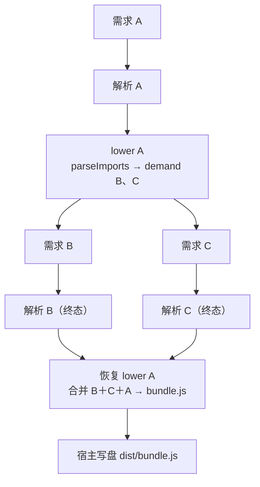

# 范本：单文件打包（A import B, C → 一个 js 脚本）

v2 协议的应用范本。回答一个实际问题：入口 A 导入 B、C，用户期望最终得到**一整个
js 脚本**——他的 hook 应该长什么样？流程是什么？

## 结论

插件形态是**模块相 lower ＋ 细粒度资源等待**：lower 里 `await ctx.demand(imports)`
拉取依赖的终态，就地合并，入口工件的终态即单文件脚本——无须等模块集排干，无须
产出相参与：

```ts
{
  name: 'single-file',
  lower: async (ctx, id, artifact) => {
    if (id !== entryId) return [artifact]          // 非入口恒等返回（按 id 自筛纪律）
    const imports = ctx.parseImports(artifact.code) // ['./b', './c']（external 由 demand 跳过）
    const deps = await ctx.demand(imports)          // 传递闭包终态：依赖先行、按 id 去重
    const code = [...deps, artifact]                // 依赖先行，入口最后
      .map((m) => stripLocalImports(m.code))        // 剥内部 import；external 保留
      .join('\n')
    return [{ path: 'bundle.js', code }]            // 覆盖入口终态为合并体（一化为一）
  },
}
```

`await ctx.demand(['./b', './c'])` 的语义：每个 specifier 经 resolve 链（相对当前
id，alias 生效）走**完整生命周期**（load → lower），返回**传递闭包**的终态——依赖
先行、按 id 去重、external 跳过。await 链成环（A 等 B、B 等 A）→ 引擎响亮报错并带
环路径；同 id 并发 demand 共享同一 Promise。

## 流程时间线

以 `A import B; A import C` 为例：



各步职责：

1. **需求 A 入队**——config `inputs` 的初始模块需求；
2. **resolve → load**——定位 id、读源码；
3. **lower A**——`parseImports` 拿到 `['./b', './c']`，`await ctx.demand(...)` 挂起；
4. **引擎调度 B、C**——各自 resolve → load → lower 至终态（若 B 的 lower 也 pull，
   递归同法）；
5. **恢复 lower A**——拿到 B、C 终态，依赖先行剥 import 拼接，返回 `bundle.js`
   作为 A 的终态（一化为一）；
6. **seal → 宿主写盘**。

## 引擎保证与插件责任

| 引擎保证 | 插件责任 |
|---|---|
| demand 返回传递闭包终态（依赖先行、去重、external 跳过） | 入口筛选（非入口恒等）、剥 import、拼接 |
| await 环响亮报错（带环路径）；同 id 并发共享同一 Promise | 环的处理：报错即修依赖；运行时包装为升级路径 |
| 登记即冻结；重名报双来源 | 派生是纯函数式重组：不改来源，只返回新工件 |

## 边界与升级路径

- **循环依赖**：await 环被引擎拒绝。范本报错；升级路径是模块运行时包装
  （`__register`/`__require` 小型注册表）——另一份范本，不混入本篇；
- **materialize 并存**：被 demand 的模块（B、C）仍留在注册表——若同时使用
  「物化全部模块」的产出会得到 bundle＋散装双份；物化类产出自行筛选（如仅入口）；
- **ESM 精确语义**：直接拼接是语义近似（未处理提升、live binding）；精确语义需要
  模块运行时包装，同上属升级路径；
- **对照：产出相图根派生**（`derive(ctx)`，模块集排干后触发）——多入口聚合、基于
  产出内容的后处理（压缩、manifest）属于那个形态；**单入口闭包内联用 pull，
  跨入口/跨产出用 derive** 是选择口径。
- **对照默认形态**：不写这个 hook，同一份输入得到的是 preserve-ESM 三文件
  （a.js/b.js/c.js，引用已重写）——单文件与否完全是 hook 的选择。
