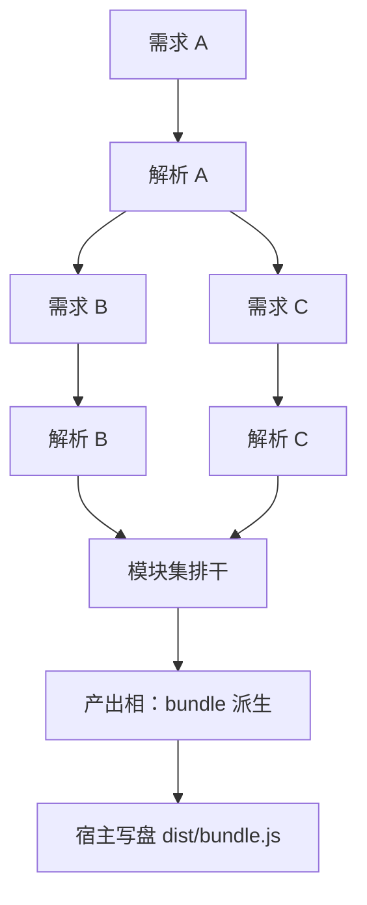

# 范本：单文件打包（A import B, C → 一个 js 脚本）

v2 协议的应用范本。回答一个实际问题：入口 A 导入 B、C，用户期望最终得到**一整个
js 脚本**——他的 hook 应该长什么样？流程是什么？

## 结论

插件形态是**产出相的图根派生**（`derive`）——不是模块相的 lower：

```ts
{
  name: 'single-file',
  derive(ctx) {
    // ctx.modules：终态模块集（全部模块已完成 resolve→load→lower，含依赖边）
    // ctx.inputs：入口清单
    const closure = collectClosure(ctx.modules, ctx.inputs) // 从各入口走依赖闭包
    if (hasCycle(closure)) throw new Error('闭包存在循环依赖：单文件拼接拒绝（运行时包装为升级路径）')
    const ordered = postOrder(closure)                      // 依赖先行，后序 DFS
    const code = ordered
      .map((m) => stripLocalImports(m.code))                // 剥内部 import；external 保留
      .join('\n')
    ctx.output({ name: 'bundle', dir: 'dist', files: [{ path: 'bundle.js', code }] })
  },
}
```

模块相**零参与**：lower 每次只见一个工件，天然拿不到兄弟模块的终态内容——跨模块的
集合级重组（合并、拆 chunk）属于产出相。这条边界就是范本的全部结构：**打包不是引擎
的职责，而是终态模块图上的一次派生**；引擎是需求图编译器，「能不能打成一个文件」
只是这个派生自己的业务逻辑。

## 流程时间线

以 `A import B; A import C` 为例：



各步职责：

1. **需求 A 入队**——config `inputs` 的初始模块需求；
2. **解析 A**——resolve（纯）定位 id；load（ctx.fs）读源码；lower 链过一遍（纯 js
   恒等）；parse 发现 `import B`、`import C` → **两个新模块需求入队**；
3. **需求 B、C 各自走完生命周期**——B、C 无 import，解析后即终态；
4. **模块集排干（quiescence）**——需求队列为空，{A, B, C} 全部冻结为终态；
5. **产出相调度**——graph-rooted 的 derive 触发：插件拿到终态模块集（含依赖边），
   走入口闭包 → 后序排序 `[B, C, A]` → 剥内部 import（external 如 `import x from
   'react'` **原样保留**）→ 拼接 → `ctx.output` 登记 `bundle`；
6. **（可选）下游派生**——`watch: ['bundle']` 的压缩 hook 被触发，登记 `bundle-min`；
7. **seal → 宿主写盘**——`dist/bundle.js` 单文件落地。

## 引擎保证与插件责任

| 引擎保证 | 插件责任 |
|---|---|
| derive 触发时模块集已排干——闭包内每个模块都是 lower 后的终态 | 闭包收集、排序、剥 import、拼接全是插件逻辑 |
| 模块注册表按 id 去重（别名/扩展名归一），环检测有记录 | 环的处理：范本选择报错；运行时包装为升级路径 |
| external（裸说明符）在模块边上已标注 | 剥 import 时保留 external |
| 登记即冻结，重名报双来源 | 派生是纯函数：不改来源，只登记新产出 |

## 边界与升级路径

- **循环依赖**：后序排序在环上无定义。范本报错；升级路径是模块运行时包装
  （`__register`/`__require` 小型注册表，webpack bootstrap 同思路）——那是另一份
  范本，不混入本篇；
- **共享模块**：多入口各自成 bundle 时，共享模块默认**每 bundle 各内联一份**（复制
  语义）；去重共享（抽公共 chunk）是 code splitting 特性，属引擎级特性而非范本能
  表达，超出 MVP；
- **ESM 精确语义**：直接拼接是语义近似（未处理提升、live binding）；精确语义需要
  模块运行时包装，同上属升级路径；
- **对照默认形态**：不写这个 hook，同一份输入得到的是 preserve-ESM 三文件
  （a.js/b.js/c.js，引用已重写）——引擎默认给「图的原样物化」，单文件与否完全是
  产出相插件的选择。
